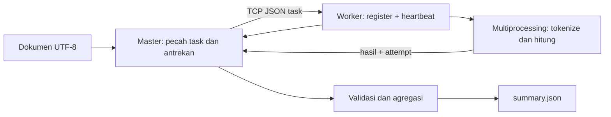

# Distributed Text Processing System (DTPS)

DTPS memecah dokumen teks menjadi task, memprosesnya pada worker melalui TCP, lalu menggabungkan frekuensi kata. Implementasi saat ini mendukung uji lokal dan penggunaan beberapa komputer dalam jaringan; simulasi proses lokal tidak dihitung sebagai 10 komputer fisik.

## Fitur

- Tokenisasi Unicode, statistik total/unik kata, dan frekuensi.
- Master–Worker melalui TCP dengan JSON length-prefix 4 byte.
- Antrean task dengan ID, status, attempt dan retry.
- Heartbeat, pemantauan CPU/RAM, scheduler dinamis atau round-robin statis.
- Pemrosesan multiprocessing di setiap worker.
- Eksekusi sequential, local multiprocessing, serta runner distributed lokal.
- Hasil eksperimen JSON dan grafik PNG.
- Dataset contoh dan generator dataset sintetis.

## Alur sistem



## Struktur penting

- `master/`: server TCP, scheduler, antrean, manager worker, fault tolerance, aggregator.
- `worker/`: client, pemantauan, processor, multiprocessing.
- `common/`, `processing/`: model, protokol, analisis.
- `benchmark/`, `scripts/`, `visualization/`: benchmark dan dataset.
- `data/sample/`: sampel.
- `results/`: data dan grafik eksperimen.
- `report/Laporan_UAS.md`: kerangka laporan.

## Instalasi

Python 3.10+ disarankan. Dari root proyek:

```powershell
python -m venv .venv
.venv\Scripts\Activate.ps1
pip install -r requirements.txt
```

## Demo satu komputer

Terminal 1:

```powershell
python -m master.main --host 0.0.0.0 --port 5000 --input data/sample/sample.txt --chunk-words 30 --auto-stop
```

Terminal 2:

```powershell
python -m worker.main --master-host 127.0.0.1 --port 5000 --processes 2
```

Master menyimpan agregasi pada `results/raw/summary.json`. Mode demo otomatis keluar setelah semua task selesai dan masa idle berakhir.

## Menjalankan beberapa Worker di satu komputer

Untuk memastikan task tidak mulai dibagikan sebelum semua Worker siap, jalankan Master dengan `--min-workers N`, lalu buka N terminal Worker dengan ID unik. Contoh untuk 3 Worker:

Terminal Master:

```powershell
python -m master.main --host 0.0.0.0 --port 5000 --input data/sample/sample.txt --chunk-words 10 --min-workers 3 --auto-stop
```

Jalankan pada tiga terminal Worker:

```powershell
python -m worker.main --master-host 127.0.0.1 --port 5000 --worker-id worker-1 --processes 2
python -m worker.main --master-host 127.0.0.1 --port 5000 --worker-id worker-2 --processes 2
python -m worker.main --master-host 127.0.0.1 --port 5000 --worker-id worker-3 --processes 2
```

Gunakan alamat IP Master LAN sebagai pengganti loopback bila Worker berada di komputer lain. Setelah semua task selesai, Master mengirim sinyal shutdown dan Worker keluar otomatis. Ringkasan memuat `tasks_by_worker` untuk menunjukkan Worker yang benar-benar mendapat task. Untuk skala 2?9, ganti N dan jalankan Worker dengan ID unik.

## Komputer berbeda dalam satu LAN

1. Jalankan Master dengan alamat bind `0.0.0.0` pada komputer Master.
2. Izinkan TCP port (default 5000) di firewall.
3. Worker harus dapat menjangkau IP LAN Master; jalankan:

```powershell
python -m worker.main --master-host 192.168.1.10 --port 5000 --processes 4
```

Ganti IP sesuai jaringan. Jangan gunakan `127.0.0.1` dari komputer worker karena alamat tersebut menunjuk ke komputer worker itu sendiri. Jalankan worker sebelum atau segera sesudah Master menerima task. Untuk mode server berkelanjutan, hilangkan `--auto-stop`; hentikan Master dengan Ctrl+C.

## Eksperimen

Sequential dan multiprocessing lokal:

```powershell
python scripts/run_experiment.py --input data/sample --processes 4 --output results
```

Buat data sintetis:

```powershell
python scripts/generate_dataset.py --output data/generated --documents 20 --words-per-document 10000
```

Skalabilitas, static-vs-dynamic dan fault-state tersedia sebagai API Python dari root proyek:

```powershell
python -c "from benchmark.scalability import run_scalability; print(run_scalability(['data/sample/sample.txt'], (1,2,4,6,9), chunk_words=10))"
python -c "from benchmark.load_balancing import compare; print(compare(['data/sample/sample.txt'], workers=2, chunk_words=10))"
python -c "from benchmark.fault_tolerance import simulate_recovery; print(simulate_recovery())"
```

Runner distributed meluncurkan Master dan worker sebagai proses lokal. Hasilnya hanya simulasi single-host. Skala worker adalah jumlah proses Worker; asumsi P untuk efficiency perlu menghitung slot proses yang digunakan, yaitu workers × processes_per_worker, dan dilaporkan terpisah dari jumlah mesin.

## Metrik dan artefak

- Execution time: waktu terukur dengan `perf_counter`.
- Speedup: T sequential / T parallel.
- Efficiency: speedup / P. P adalah slot proses worker terkonfigurasi, bukan jumlah mesin.
- Throughput: unit kerja / detik.
- CPU: persentase host yang dilaporkan psutil; interpretasikan sebagai pemantauan host, bukan agregat akurat seluruh komputer.
- Memori: RSS proses runner dalam MiB; bukan total RAM seluruh worker.
- Recovery time pada fungsi simulasi adalah waktu transisi state antrean. Untuk recovery jaringan sesungguhnya ukur outage-to-requeue pada percobaan terpisah.
- JSON dan grafik disimpan di `results/`. Jangan isi laporan dengan angka contoh; jalankan eksperimen dan simpan hasil mentah.

## Pengujian

```powershell
pytest -q
```

Suite berisi unit test model, protokol, task queue, scheduler, aggregator, fault tolerance, dan server. Jalankan dari root proyek.

## Troubleshooting

- `Connection refused`: cek IP, port, firewall, dan pastikan Master sudah listen.
- Worker tidak menerima task: periksa input Master dan status antrean.
- Worker offline: cek konektivitas serta kesesuaian heartbeat timeout/interval.
- Port bentrok: pilih port lain yang sama pada Master dan Worker.
- Windows multiprocessing: jalankan modul dengan `python -m` dari root; entry point Worker memakai `freeze_support()`.

## Pembagian tugas kelompok

Ketentuan PDF UAS: kelompok terdiri dari 3 mahasiswa. Bagi tanggung jawab nyata di antara tiga anggota, misalnya (1) Master, protokol dan antrean; (2) Worker, multiprocessing dan pemulihan; (3) benchmark, pengujian jaringan, visualisasi dan laporan. Cantumkan nama serta kontribusi sesuai pekerjaan yang benar-benar dilakukan.

## Keterbatasan

PDF UAS mensyaratkan 1 Master + 9 Worker pada minimal 10 komputer fisik dan video demonstrasi maksimal 5 menit yang membuktikan penggunaan 10 node tersebut. Lingkungan pengembangan satu komputer hanya dapat menguji simulasi beberapa proses dan loopback TCP. Persyaratan tersebut masih menunggu pengukuran pada jaringan fisik; uji skalabilitas lokal tidak membuktikan performa fisik atau kualitas jaringan antar-komputer.

## Sumber dataset
File sampel ditulis untuk proyek ini dan dataset besar dibuat secara sintetis oleh scripts/generate_dataset.py dari daftar kata yang disertakan. Proyek tidak mengambil dataset eksternal; karena itu tidak ada sumber dataset eksternal yang perlu dikutip. Cantumkan referensi resmi untuk teori atau rumus yang Anda tambahkan ke laporan akhir.
